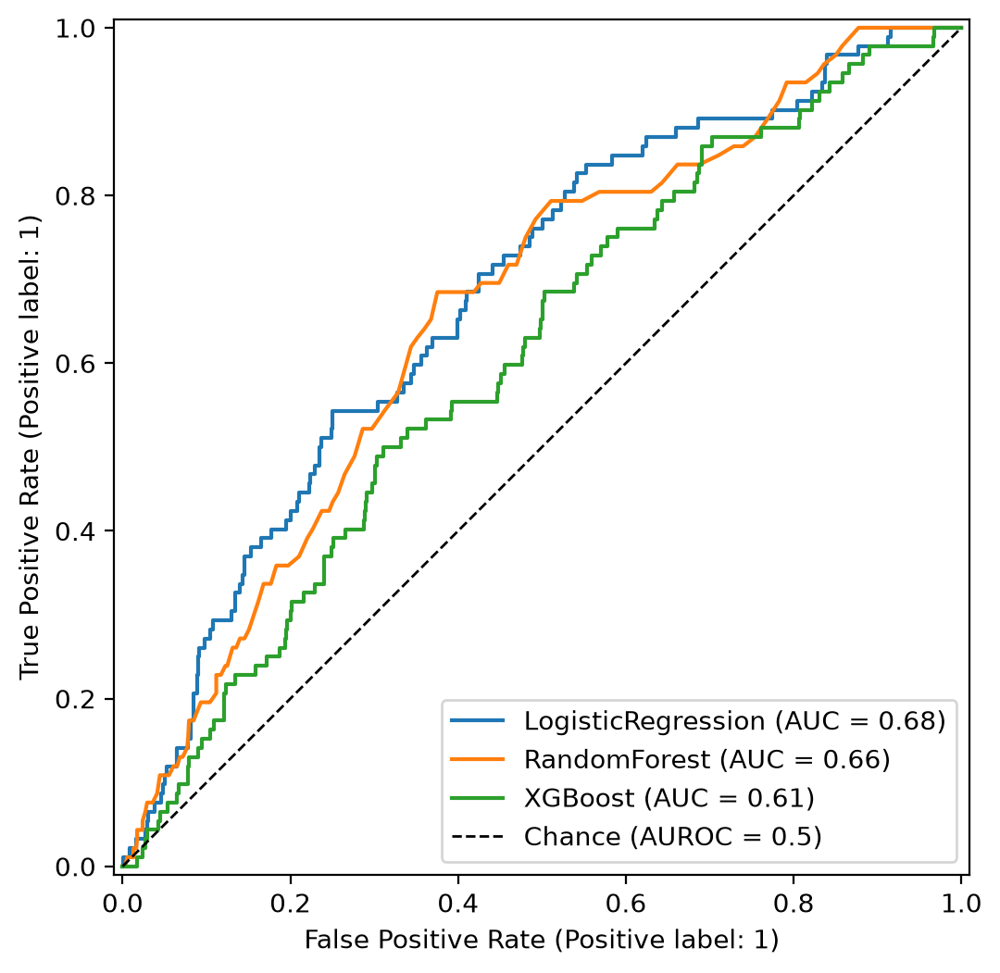
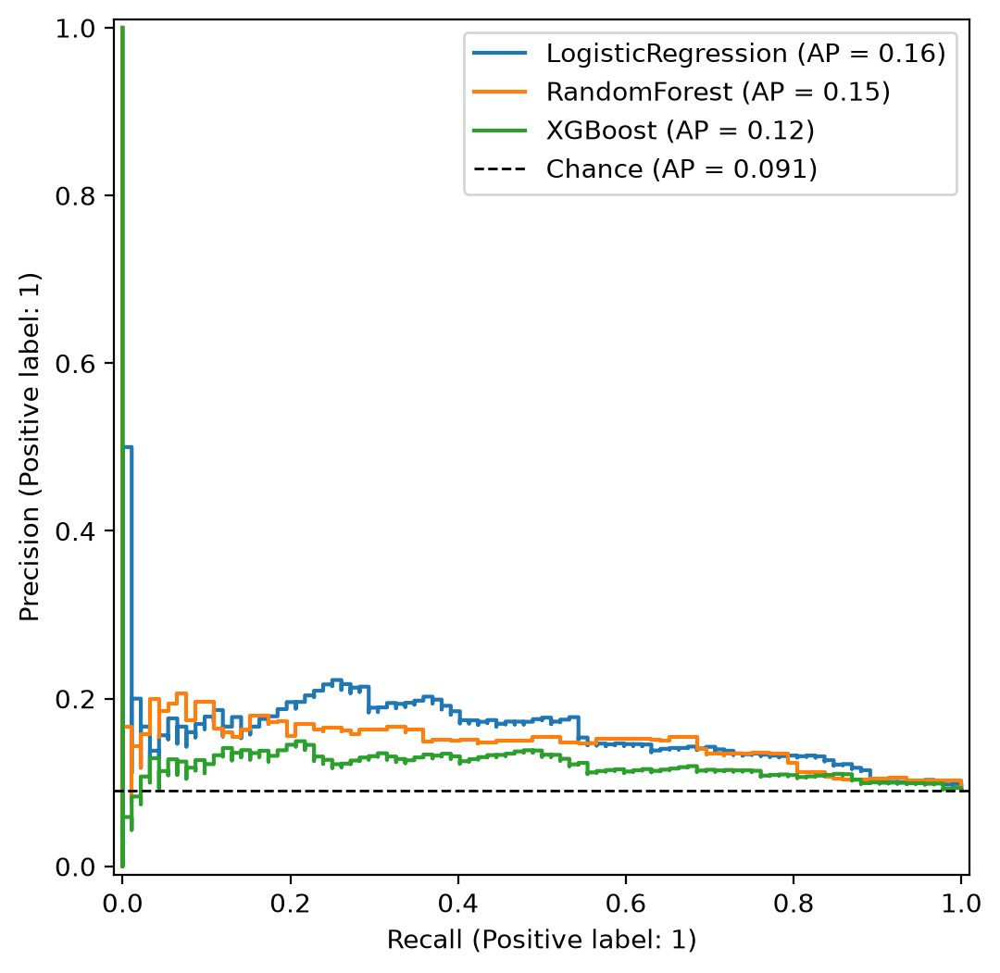
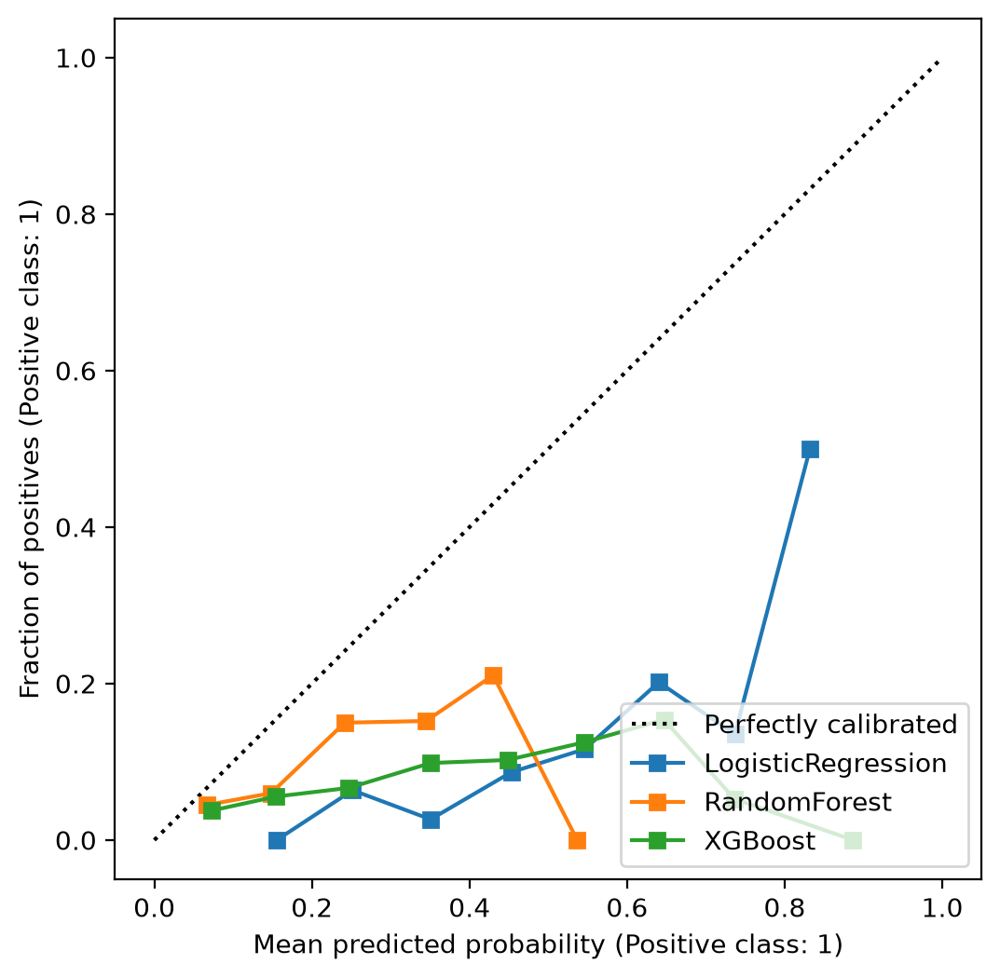
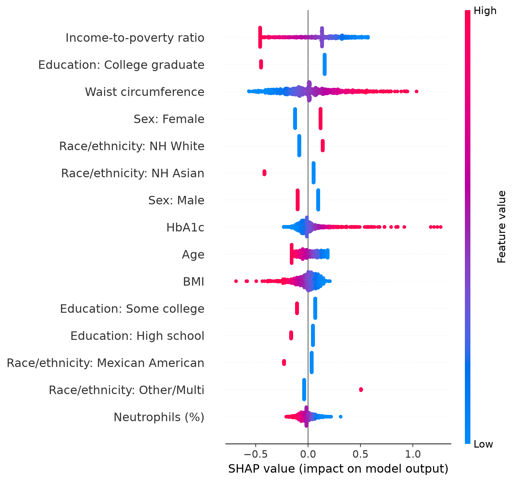
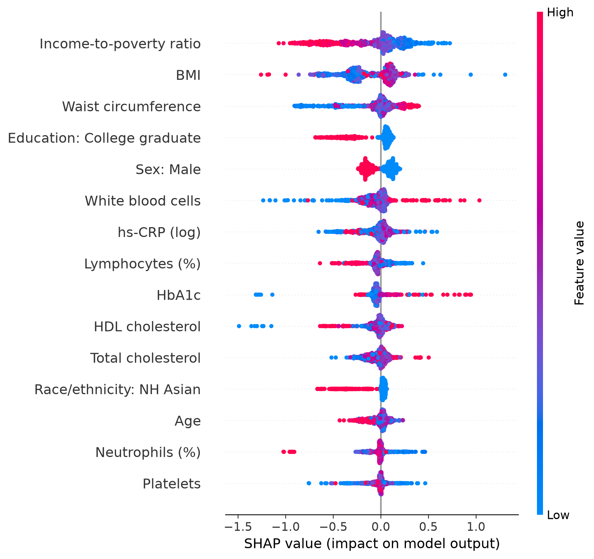

# Depression Risk Prediction from Routine Clinical Data (NHANES 2017–2018)

## Overview
Depression is common but under-detected in routine care. This project asks whether
**routinely collected demographic, anthropometric and laboratory data**, including the
inflammatory marker hs-CRP, can identify adults with clinically relevant depressive
symptoms (PHQ-9 ≥ 10), and whether hs-CRP adds predictive value beyond the other measures.

It is built as a **reproducible, modular ML pipeline**: one command downloads the public
data, cleans it, trains and compares models with cross-validation, evaluates them on a
held-out test set with bootstrap confidence intervals, explains them with SHAP, and runs
an hs-CRP ablation analysis.

## Data
- **Source:** [NHANES 2017–2018](https://wwwn.cdc.gov/nchs/nhanes/continuousnhanes/default.aspx?BeginYear=2017), CDC (public, no registration)
- **Modules:** DEMO, DPQ (PHQ-9), HSCRP, BMX, CBC, GHB, HDL, TCHOL
- **Outcome:** PHQ-9 total ≥ 10 (moderate-to-severe depressive symptoms)
- **Predictors (16):**
  - *Demographic:* age, sex, race/ethnicity, education, income-to-poverty ratio
  - *Anthropometric:* BMI, waist circumference
  - *Laboratory:* hs-CRP (log-transformed), white blood cells, neutrophils (%), lymphocytes (%), haemoglobin, platelets, HbA1c, HDL cholesterol, total cholesterol

**Study population**

| Step | N |
|---|---|
| All NHANES 2017–2018 participants | 9,254 |
| Adults (age ≥ 18) | 5,856 |
| Complete PHQ-9 (final sample) | **5,068** (prevalence 9.1%) |
| Train / test split (stratified 80/20) | 4,054 / 1,014 |

Raw data are not stored in this repo; `src/download.py` fetches them from the CDC.

## Methods
- **Preprocessing:** tables merged on participant ID (left join on DEMO); PHQ-9 refusal/don't-know codes (7/9) set to missing; total score computed only when all 9 items are answered; hs-CRP log-transformed (`log1p`)
- **Leakage control:** median/mode imputation, standardisation and one-hot encoding are fitted inside a scikit-learn `Pipeline`, i.e. on training folds only
- **Models:** logistic regression, random forest, XGBoost; class weighting for the 9% outcome prevalence
- **Validation:** stratified 80/20 train–test split; 5-fold stratified cross-validation on the training set
- **Decision thresholds:** chosen separately for each model by maximising Youden's J on out-of-fold training predictions, then applied unchanged to the test set
- **Metrics:** AUROC, AUPRC, sensitivity, specificity, calibration; 95% CIs for test AUROC from 1,000 bootstrap resamples
- **Explainability:** SHAP (LinearExplainer for logistic regression, TreeExplainer for XGBoost)
- **hs-CRP ablation:** each model retrained without hs-CRP; the test-set AUROC difference is assessed with a paired bootstrap (1,000 resamples)

## Results

### Discrimination

| Model | CV AUROC (mean ± SD) | CV AUPRC | Test AUROC (95% CI) | Test AUPRC |
|---|---|---|---|---|
| **Logistic regression** | **0.634 ± 0.031** | **0.157** | **0.680 (0.625–0.733)** | **0.162** |
| Random forest | 0.603 ± 0.041 | 0.143 | 0.663 (0.604–0.714) | 0.147 |
| XGBoost | 0.581 ± 0.060 | 0.132 | 0.606 (0.548–0.664) | 0.120 |

AUPRC baseline (chance) = outcome prevalence = 0.091.

### Classification at Youden-optimal thresholds (test set)

| Model | Threshold | Sensitivity | Specificity |
|---|---|---|---|
| Logistic regression | 0.522 | 0.543 | 0.696 |
| Random forest | 0.173 | 0.696 | 0.551 |
| XGBoost | 0.379 | 0.598 | 0.531 |

Model-specific thresholds matter: at a fixed threshold of 0.5 the random forest classified
no participant as positive (sensitivity 0.000) despite an AUROC of 0.66, because its
predicted probabilities rarely exceeded 0.5.

### hs-CRP ablation (test set)

| Model | AUROC with hs-CRP | AUROC without hs-CRP | ΔAUROC (95% CI) |
|---|---|---|---|
| Logistic regression | 0.680 | 0.681 | −0.000 (−0.003 to 0.003) |
| Random forest | 0.663 | 0.650 | 0.013 (−0.011 to 0.037) |
| XGBoost | 0.606 | 0.592 | 0.015 (−0.010 to 0.041) |

### Figures

<p float="left">
  
  
  
</p>
<p float="left">
  
  
</p>

*Top: ROC, precision–recall and calibration curves. Bottom: SHAP summaries for logistic regression (left) and XGBoost (right).*

### Key findings
- Routine demographic and laboratory data showed **modest discrimination** for depressive symptoms (best test AUROC 0.68, 95% CI 0.63–0.73). The simplest model, logistic regression, performed at least as well as the tree-based models and was the most stable across folds.
- **Socioeconomic factors were the strongest predictors** in both explained models: lower income-to-poverty ratio and not having a college degree were associated with higher predicted risk. Female sex, larger waist circumference and higher HbA1c also consistently increased predicted risk.
- **hs-CRP added no detectable predictive value** once demographic, adiposity and metabolic measures were included. Removing it left logistic-regression performance unchanged (ΔAUROC −0.000, 95% CI −0.003 to 0.003), and the confidence intervals spanned zero for all models. This agrees with SHAP, where hs-CRP was not among the top 15 features for logistic regression and showed no consistent direction in XGBoost. One plausible explanation is that much of the information in hs-CRP is shared with central adiposity.
- All models were **poorly calibrated**: class weighting inflated predicted probabilities, so outputs should be read as risk rankings, not absolute risks.

## Limitations
- Cross-sectional data: findings are associations, not causal effects. The ablation measures *incremental* predictive value and does not show that hs-CRP is unrelated to depression.
- PHQ-9 is a screening questionnaire, not a clinical diagnosis.
- Single survey cycle with no external validation; NHANES survey weights were not applied, so results do not generalise directly to the US population.
- Small number of test-set cases (~92 positives), hence wide confidence intervals.
- Probabilities were not recalibrated; default hyperparameters were used without tuning.
- Missing predictor values were handled by single (median/mode) imputation. Education is only recorded for adults aged ≥ 20, so it was imputed for 18–19-year-olds, and its refused/don't-know codes were kept as separate categories.
- Important correlates of depression (e.g. sleep, chronic disease, substance use, life events) were deliberately excluded to focus on routine clinical measures.

## How to run
```bash
git clone https://github.com/hujy3382-ops/nhanes-depression-prediction.git
cd nhanes-depression-prediction
pip install -r requirements.txt
python main.py                    # full pipeline (downloads data on first run)
python main.py --skip-download    # re-run once data are downloaded
pytest -v                         # unit tests
```
All settings (variables, paths, seed, CV folds) are in `config.yaml`. Outputs are written to `results/` and `figures/`.

## Project structure
```
├── main.py              # end-to-end pipeline entry point
├── config.yaml          # data sources, variables, paths, settings
├── src/
│   ├── download.py      # fetch NHANES .xpt files from the CDC
│   ├── preprocess.py    # merge tables, clean and score PHQ-9, build outcome
│   ├── train.py         # pipelines, models, cross-validation, threshold selection
│   ├── evaluate.py      # test-set metrics and ROC / PR / calibration plots
│   ├── explain.py       # SHAP explanations
│   ├── ablation.py      # bootstrap CIs and hs-CRP ablation
│   └── utils.py         # config loading, seeding, helpers
├── tests/               # pytest unit tests
├── results/             # generated tables (CSV)
└── figures/             # generated figures
```

## Author
Jiayi Hu, MSc Cognitive Neuroimaging and Data Science, University of Birmingham
